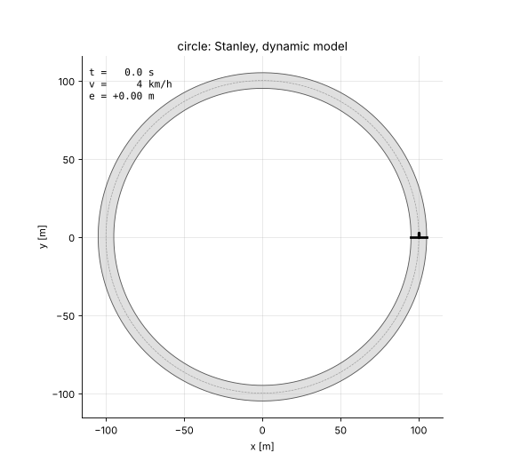
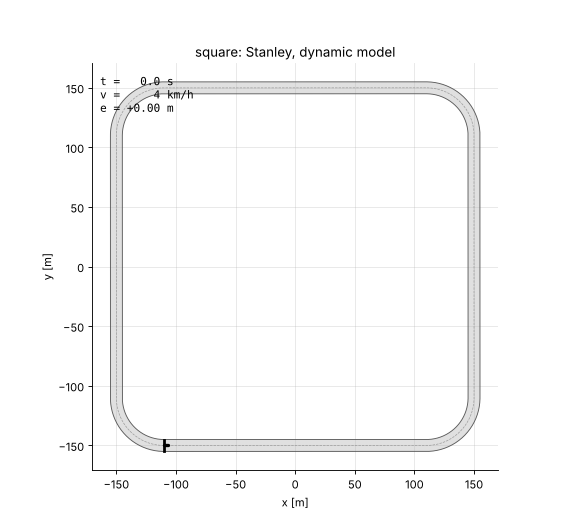
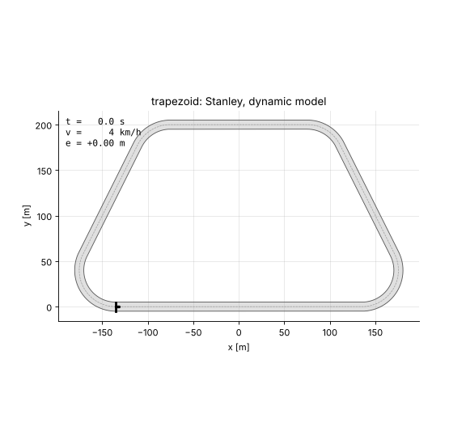
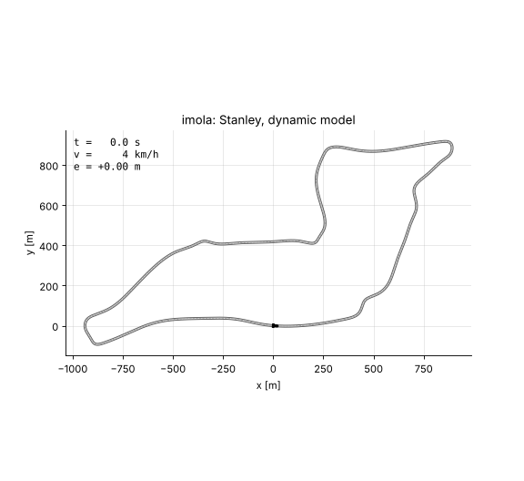
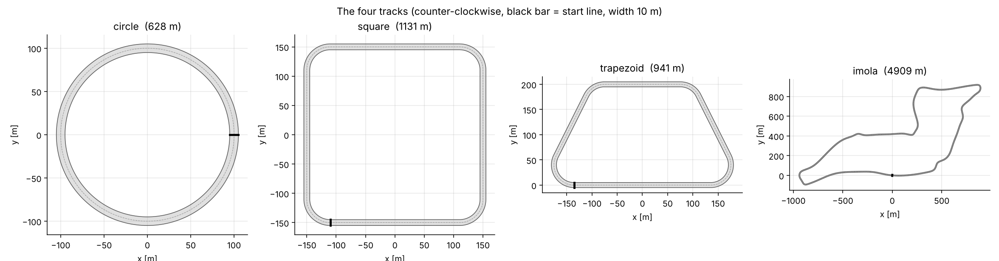
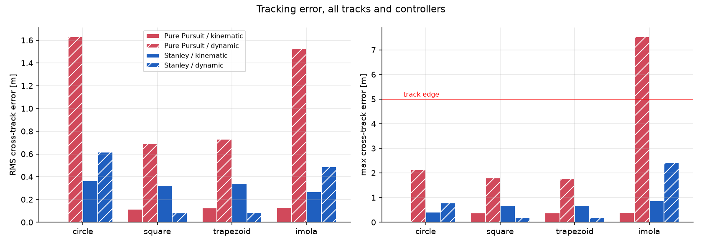
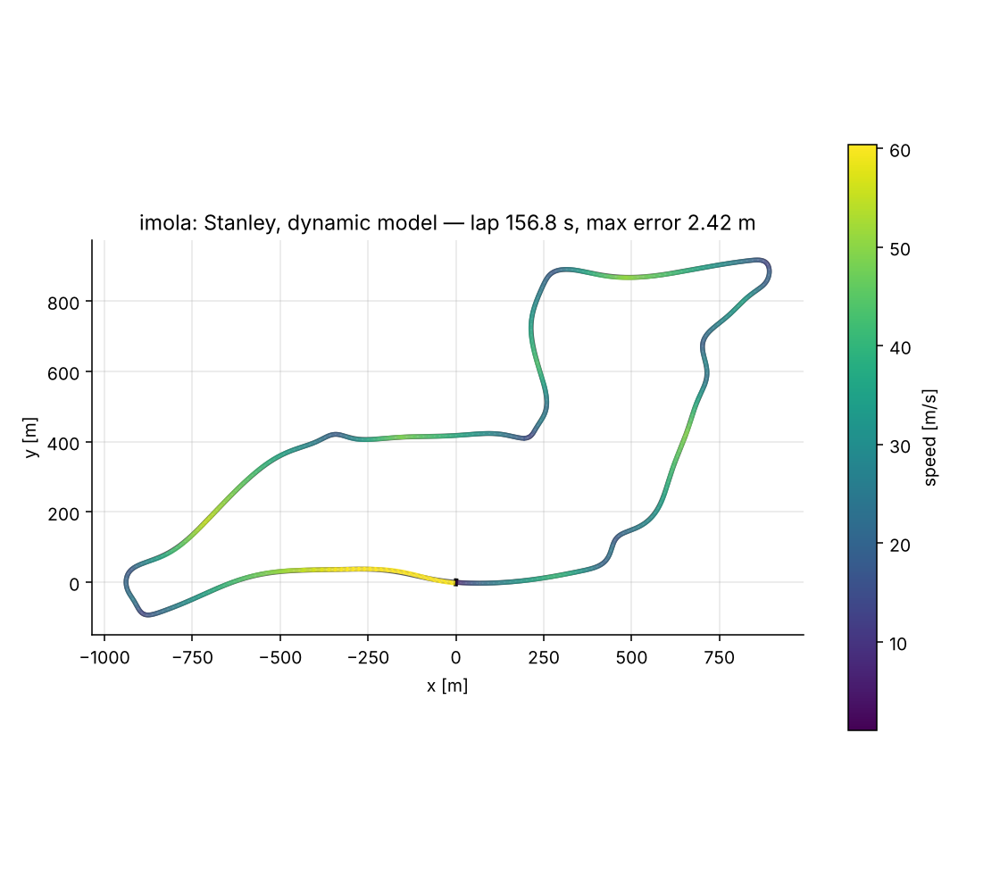
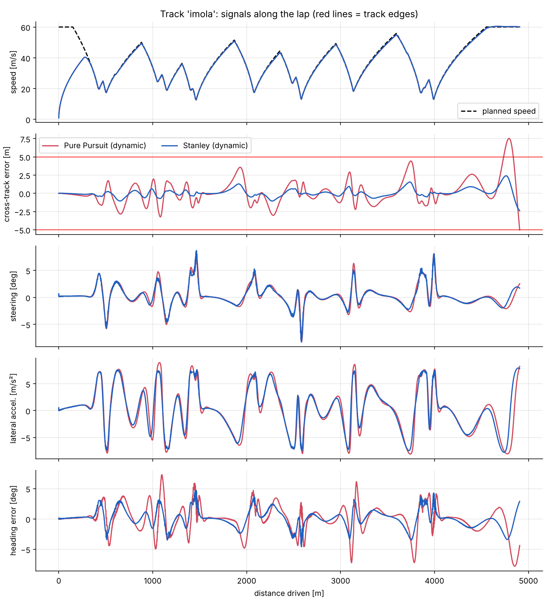

# Autonomous Path Following — Pure Pursuit and Stanley on Circle, Square, Trapezoid and Imola

**A simulated car drives one lap, from a standing start, on a track you choose: a circle, a
rounded square, a rounded trapezoid or the Imola F1 circuit.** Two lateral controllers
(Pure Pursuit and Stanley) and a speed controller are compared on two vehicle models
(kinematic and dynamic bicycle). Everything is plain Python and can be re-run and checked.

| Circle | Square |
|---|---|
|  |  |

| Trapezoid | Imola |
|---|---|
|  |  |

> **Provenance.** The idea comes from the autonomous-car (path-following) topic of my M.Sc. in
> Automation Engineering at the University of Bologna, where the track was a circle. This
> repository is a later, independent re-implementation in Python, extended to four tracks, a
> dynamic vehicle model, an automated test suite and this report. It is a **simulation study**;
> no real vehicle was involved.

---

## 1. Summary

| | |
|---|---|
| Task | Drive one closed lap from standstill, stay inside a 10 m wide track, go as fast as the tyres allow |
| Tracks | circle (628 m), rounded square (1131 m), rounded trapezoid (941 m), Imola (4909 m) |
| Vehicle | generic road car: 1500 kg, wheelbase 2.7 m, steering ≤ 0.45 rad at ≤ 0.8 rad/s |
| Vehicle models | kinematic bicycle; dynamic bicycle (lateral tyre forces with saturation at μ = 1) |
| Lateral control | Pure Pursuit, Stanley (with curvature feed-forward) |
| Speed control | curvature-based speed profile (7 m/s² lateral, 3 m/s² accel., 6 m/s² braking) + PI with feed-forward |
| Result | Stanley completes all four tracks on both models inside the track; max error 0.2 m (square/trapezoid), 0.8 m (circle), 2.4 m (Imola, dynamic) |
| Tests | 29 automated tests (`pytest`) |

---

## 2. Tracks



Every track is a centreline sampled every 1 m with exact heading ψ(s) and signed curvature κ(s),
counter-clockwise, start at s = 0.

* **Circle**: radius 100 m.
* **Square / trapezoid**: sharp polygons are impossible to drive at speed (a car cannot turn
  instantly), so the corners are replaced by tangent arcs of radius 40 m. Square 300 m side,
  trapezoid 400 m / 200 m bases and 200 m height.
* **Imola**: see Section 6. Lap length is fixed to the official 4909 m.

---

## 3. Models

**Kinematic bicycle** (no tyre slip, rear-axle reference), state (x, y, ψ, v):

ẋ = v cos ψ, ẏ = v sin ψ, ψ̇ = v tan δ / L, v̇ = a

**Dynamic bicycle** (centre-of-gravity reference), state (x, y, ψ, vₓ, v_y, r): linear tyres
with cornering stiffness C_f = 100 kN/rad, C_r = 120 kN/rad, force saturation at μ F_z through a
`tanh`, yaw inertia 2500 kg m². Unlike the kinematic model it understeers and can lose grip.

Both are integrated with RK4 (dt = 10 ms). The steering command is limited in angle and rate.

---

## 4. Control

* **Speed profile.** v(s) = √(a_lat / |κ(s)|), capped at 60 m/s, then a forward pass (acceleration
  limit) and a backward pass (braking limit) around the closed loop.
* **Speed controller.** PI on the speed error plus feed-forward of the planned acceleration, with
  3 m/s² and 6 m/s² limits.
* **Pure Pursuit.** Aims at the centreline point L_d = 4 m + 0.45 s · v ahead and steers
  δ = atan(2 L sin α / L_d).
* **Stanley.** δ = (ψ_ref − ψ) − atan(k e / (k_s + v)) + atan(L κ) evaluated at the front axle,
  k = 2.

---

## 5. Results

All 16 combinations (`python run_comparison.py`, file `results/comparison.md`):

| track | controller | model | lap [s] | RMS e [m] | max e [m] | off-track [%] | max a_y [m/s²] |
|---|---|---|---|---|---|---|---|
| circle | pure_pursuit | kinematic | 27.7 | 0.00 | 0.00 | 0.0 | 7.3 |
| circle | pure_pursuit | dynamic | 28.2 | 1.63 | 2.14 | 0.0 | 7.4 |
| circle | stanley | kinematic | 27.7 | 0.36 | 0.41 | 0.0 | 8.7 |
| circle | stanley | dynamic | 27.9 | 0.62 | 0.78 | 0.0 | 7.3 |
| square | pure_pursuit | kinematic | 53.4 | 0.12 | 0.37 | 0.0 | 7.8 |
| square | pure_pursuit | dynamic | 53.8 | 0.69 | 1.79 | 0.0 | 8.4 |
| square | stanley | kinematic | 53.2 | 0.32 | 0.68 | 0.0 | 8.8 |
| square | stanley | dynamic | 53.4 | 0.08 | 0.20 | 0.0 | 7.9 |
| trapezoid | pure_pursuit | kinematic | 47.3 | 0.12 | 0.38 | 0.0 | 7.8 |
| trapezoid | pure_pursuit | dynamic | 47.7 | 0.73 | 1.79 | 0.0 | 8.4 |
| trapezoid | stanley | kinematic | 47.1 | 0.34 | 0.68 | 0.0 | 8.6 |
| trapezoid | stanley | dynamic | 47.4 | 0.08 | 0.20 | 0.0 | 7.8 |
| imola | pure_pursuit | kinematic | 156.2 | 0.13 | 0.40 | 0.0 | 8.0 |
| imola | pure_pursuit | dynamic | 157.7 | 1.53 | 7.53 | 1.1 | 9.0 |
| imola | stanley | kinematic | 156.0 | 0.27 | 0.87 | 0.0 | 8.9 |
| imola | stanley | dynamic | 156.8 | 0.49 | 2.42 | 0.0 | 8.0 |



**Reading the table**

* On the **kinematic** model Pure Pursuit is almost perfect (it is geometrically exact for that
  model on a constant-radius arc). Stanley has a small constant offset because it is evaluated at
  the front axle while the error is reported for the rear axle.
* On the **dynamic** model the picture reverses. Pure Pursuit has no knowledge of understeer, so it
  cuts corners (1.6 m RMS on the circle) and on Imola it leaves the 10 m track for 1.1 % of the lap
  (max 7.5 m). Stanley's cross-track feedback compensates and stays inside everywhere.
* Lateral acceleration reaches 7–9 m/s² (the planning limit is 7; transients go higher), still
  below the tyre limit of ≈ 9.8 m/s² used by the model.

Example for the Imola lap (Stanley, dynamic): trajectory coloured by speed and signals along the lap.





Other tracks: `results/*.gif`, `results/figures/<track>_trajectory.png`, `<track>_signals.png`.

---

## 6. Imola data

The Imola centreline was **traced from the official track map** (the blue line of the
"Tracciato Auto" map, 4.909 km): colour mask → skeleton → ordered loop → periodic spline →
counter-clockwise, start at the start/finish line → scaled to the printed lap length 4909 m.
The script is `tools/trace_map.py`; its result is `pathfollow/data/imola_centerline.csv`
(982 points, every 5 m). The map image is not redistributed; the circuit layout is © of its owners
and used here only to define a path for a control exercise.

**Accuracy limits.** The map is a drawing, not survey data. After smoothing the tightest traced
radius is about 23 m, while the map labels radii down to about 14 m at the chicanes, so the chicanes
are *smoothed* and the speeds in the simulation are therefore optimistic there. Width (10 m) is a
constant assumption, and no elevation is modelled.

---

## 7. Limitations (please read)

* **Simulation only**, no comparison with a real vehicle or with real Imola lap data. A generic
  road car is simulated, not an F1 car (no aerodynamic downforce), so the lap times (≈ 157 s) are
  not comparable to real F1 laps.
* Speed planning uses a lateral limit only, with no combined (g-g) braking/cornering coupling.
* Square and trapezoid corners are rounded (R = 40 m); the controllers are not tested on
  sharp-cornered paths.
* Controller gains were tuned by hand on these tracks; no robustness study (noise, delay,
  friction changes) was done.
* The dynamic model computes slip angles with max(vₓ, 1 m/s) to stay well-defined at standstill, so the first metres of the lap are only approximately modelled.

---

## 8. How to run

```bash
pip install -r requirements.txt

python run_simulation.py                       # asks which track to drive, opens figures
python run_simulation.py --track imola --controller stanley --model dynamic
python run_simulation.py --track circle --no-show   # only write files

python run_animation.py                         # asks which track, opens an animation window
python run_animation.py --track square          # animation window for one track
python run_animation.py --track all --gif       # all four GIFs in results/

python run_comparison.py                        # table of all 16 combinations
python -m pytest -q                             # 29 tests (about 10 s)
```

Figures are always saved to `results/figures/`; by default they also open in windows.

### Layout

```
pathfollow/
  tracks.py       circle, rounded polygons, Imola; projection onto the centreline
  vehicle.py      kinematic and dynamic bicycle models (RK4)
  profile.py      curvature-based speed profile
  controllers.py  Pure Pursuit, Stanley, speed PI
  simulate.py     closed-loop lap and metrics
  plotting.py, animation.py
  data/imola_centerline.csv
tools/trace_map.py   centreline extraction from a map image
run_simulation.py  run_animation.py  run_comparison.py
tests/test_pathfollow.py
```

## 9. License

MIT, see [`LICENSE`](LICENSE).
